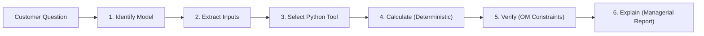

# Supply Chain Analytics Inventory Decision Agent

An intelligent, deterministic Operations Management & Supply Chain Inventory Decision Agent that accepts natural-language inventory management questions and executes rigorous operations research models.

---

## 🏛 Architecture: 6-Stage Agentic Pipeline

The decision agent implements an end-to-end 6-stage pipeline:



1. **Customer Question**: Ingests raw natural language queries.
2. **Identify Model**: Classifies query into one of 5 supported inventory models with confidence scoring and semantic cues.
3. **Extract Inputs**: Extracts numerical parameters, currency, percentages, units of time (days, weeks, months), and discount schedules.
4. **Select Python Tool**: Dynamically routes to the corresponding calculation engine in `inventory_tools.py`.
5. **Calculate**: Executes pure Python deterministic calculations with zero hallucination.
6. **Verify**: Audits physical, statistical, and economic constraints ($D > 0$, $0 < \text{CSL} < 1$, $p > c > s$, $AOC \approx AHC$).
7. **Explain**: Generates an executive-ready supply chain decision report with LaTeX formulas, step-by-step substitution, financial breakdown tables, and strategic managerial insights.

---

## 📦 Supported Inventory Models & Mathematics

| # | Model | Core Mathematical Formulation | Key Output Decisions |
| :--- | :--- | :--- | :--- |
| **1** | **Economic Order Quantity (EOQ)** | $Q^* = \sqrt{\frac{2DS}{H}}$, $TAC = \frac{D}{Q}S + \frac{Q}{2}H$ | Optimal lot size $Q^*$, cycle time, order frequency, annual ordering & holding costs. |
| **2** | **Quantity Discount Model** | $Q_j = \sqrt{\frac{2DS}{H_j}}$, evaluate $TC(Q)$ at feasible $Q$ & price breakpoints | Best tier, optimal order size, total cost comparison across all brackets, cost savings. |
| **3** | **Safety Stock & Reorder Point (ROP)** | $SS = z \cdot \sigma_L$, $ROP = \mu_L + SS$, where $z = \Phi^{-1}(CSL)$ | Safety buffer, reorder trigger point, stockout risk per cycle, carrying cost of buffer. |
| **4** | **Fixed-Period Review Model** | $M = d(R+L) + z \cdot \sigma_d \sqrt{R+L}$, $Q = \max(0, M - IP)$ | Order-up-to level $M$, order recommendation for current cycle, continuous vs periodic comparison. |
| **5** | **Newsvendor Model** | $CR = \frac{C_u}{C_u + C_o} = \frac{p-c+g}{p-s+g}$, $Q^* = \mu + z^* \sigma$ | Optimal seasonal order size $Q^*$, expected sales, expected lost sales, expected leftover, EVPI. |

---

## 📂 Project Structure

```
BAN517_Inventory_Agent/
├── app.py                     # Interactive CLI & Streamlit application
├── inventory_agent.py         # 6-stage Supply Chain Decision Agent
├── inventory_tools.py         # Deterministic numerical models (zero external dependencies)
├── requirements.txt           # Project dependencies
├── tests/
│   └── test_inventory_tools.py # Comprehensive unit and integration test suite (16 tests)
└── README.md                  # Documentation and usage guide
```

---

## 🚀 Quickstart & Usage

### 1. Run the Interactive CLI
```bash
python3 app.py
```
Type any natural-language question or select `1`–`5` to execute textbook benchmark problems.

### 2. Run a Single Natural-Language Query
```bash
python3 app.py --query 'Our annual demand is 10,000 units, order cost is $50 per order, and holding cost is $2 per unit per year. Purchase price is $10. What is our EOQ?'
```

### 3. Run the 5-Model Benchmark Suite
```bash
python3 app.py --demo
```

### 4. Run the Test Suite
```bash
python3 -m unittest discover -s tests -v
```

### 5. Launch Web Dashboard (Optional)
```bash
pip install streamlit
streamlit run app.py
```

---

## 🧪 Benchmark Verification

The suite includes 16 automated tests covering:
- Standard normal quantile ($\Phi^{-1}$), CDF ($\Phi$), and unit normal loss function $L(z)$.
- Classical EOQ lot sizing and cost balance ($AOC = AHC$).
- All-units quantity discount breakpoint evaluation.
- Continuous review $(s, Q)$ with constant and stochastic lead times.
- Periodic review Order-Up-To base stock $(R, S)$ protection horizon.
- Newsvendor critical fractile with Normal, Uniform, and Discrete distributions.
- End-to-end natural language agent pipeline parsing and verification.
